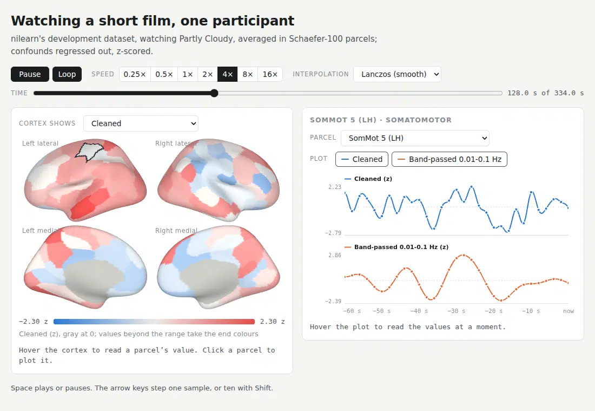
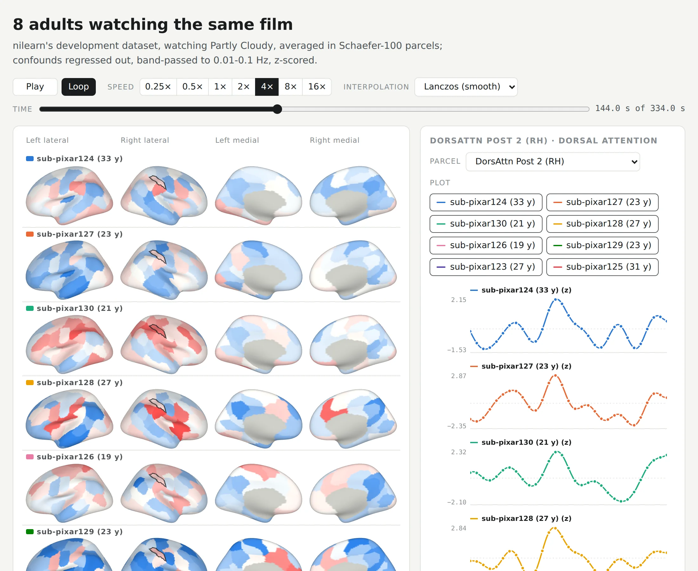
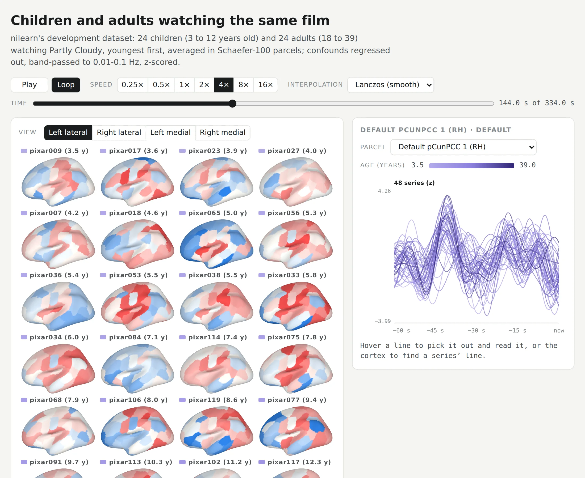

# parcelview

<picture>
  <source media="(prefers-color-scheme: dark)" srcset="docs/images/opener-dark.webp">
  
</picture>

parcelview plays parcel time series on the cortex. You give it a parcellation and one or more `(time, parcel)`
arrays, and it writes one HTML page that you can open in any modern browser, offline, or show in a notebook.

The page has the following parts:

- **Cortex:** four views, left and right lateral on top and left and right medial below, that colour every
  parcel by one series at the current moment. Hover a parcel to read its value. The cortex can instead draw
  every series at once, in rows of four views or in a grid of one view each.
- **Plots:** click a parcel, or pick it from the menu, to plot its series over the last minute, one row per
  series. Toggle buttons choose which series to plot. For many series, the plot overlays them all on one
  axis instead.
- **Playback:** play, pause, speed, loop, a timeline, and the interpolation between samples: Lanczos
  (band-limited, so smooth and through every sample), linear, or nearest sample. The interpolation applies
  to the cortex and the plots alike.

Series can be sampled at different rates, such as fMRI every 2 s next to MEG source power every 0.05 s in
the same parcels.

## Install

```
pip install parcelview
```

parcelview needs Python 3.10 or later, with NumPy, nibabel, and nilearn. The page needs a browser with
WebGL 2.

## Quick start

```python
import numpy as np
import parcelview as pv

atlas = pv.Atlas.schaefer(200)           # Schaefer 2018, 200 parcels, on fsaverage5
bold = np.random.randn(400, 200)         # replace with your (time, parcel) data
page = pv.view({'BOLD': bold}, atlas, tr=0.8, units='%')
page.save('bold.html')                   # or page.open(), or leave `page` last in a notebook cell
```

Columns follow the atlas's parcel order. If your data is a pandas or polars DataFrame whose columns are parcel
names, parcelview matches the columns to the atlas by name.

## Atlases

An `Atlas` assigns each surface vertex to a parcel. Create one from any of these sources:

| Source | Constructor | Drawn on |
| --- | --- | --- |
| Schaefer 2018, 100 to 1,000 parcels, 7 or 17 networks | `Atlas.schaefer(n_parcels, networks)` | fsaverage5, fsaverage6, or fsaverage |
| FreeSurfer annotation files | `Atlas.from_annot(lh, rh)` | the fsaverage mesh that matches the vertex count |
| GIfTI label files | `Atlas.from_gifti(lh, rh)` | the fsaverage or fsLR mesh that matches the vertex count |
| CIFTI dense label file, such as an HCP parcellation | `Atlas.from_cifti(path)` | fsLR 32k |
| Volumetric label image, such as AAL or Harvard-Oxford | `Atlas.from_volume(img, names)` | fsaverage5, after projection |
| Arrays of parcel indices | `Atlas.from_arrays(left, right, names)` | any mesh you pass |

parcelview downloads the Schaefer annotations from the CBIG repository and the fsLR meshes from TemplateFlow
once, and keeps them in `~/.cache/parcelview` (set `PARCELVIEW_DATA` to change this). For any other mesh, pass
`surface=pv.Surface.from_files(lh, rh)` with GIfTI or FreeSurfer surface files.

Parcels that cover no vertex, such as subcortical regions in a CIFTI file or a volumetric atlas, stay in the
atlas. The page lists them in the parcel menu and plots their time courses, but it can't draw them on the
cortex.

You can change an atlas with these methods:

- `atlas.reorder(names)` puts the parcels in the order of your data's columns. Names that aren't in the atlas
  become parcels that are listed but not drawn.
- `atlas.with_labels(...)` changes the names the page shows.
- `atlas.with_groups(...)` groups the parcel menu, for example by network. `Atlas.schaefer` sets each
  parcel's Yeo network as its group.
- `atlas.rename(...)` changes the names that parcelview matches against your data.

## Several series

Pass a mapping from name to `(time, parcel)` array. Each series has its own sampling interval, start time,
unit, and colour range:

```python
page = pv.view(
    {'BOLD': bold, 'MEG power': meg},
    atlas,
    tr={'BOLD': 2.0, 'MEG power': 0.05},
    units={'BOLD': '%', 'MEG power': 'dB'},
    plot=['BOLD'],                 # plotted when the page opens; the viewer can toggle the others
)
```

[`examples/movie_fmri.py`](examples/movie_fmri.py) builds the page shown at the top of this README: one
participant from the [Partly Cloudy dataset](#data-in-the-examples) of Richardson et al. (2018), watching a short
film, with the cleaned BOLD signal and a band-passed copy in Schaefer-100 parcels.

## Several series side by side

By default the cortex draws one series at a time, and the viewer picks which from a menu. To compare series
moment by moment, such as participants who saw the same stimulus, have the cortex draw them all at once:

- `cortex='rows'` draws each series in its own row of four views. It suits a few series.
- `cortex='grid'` draws each series in one view, packed in a grid, and the viewer picks the view. It suits
  dozens of series.

Either way the series share one colour range by default, computed over all of them together, so the same
colour means the same value everywhere.

```python
page = pv.view({'Participant 1': p1, 'Participant 2': p2, 'Participant 3': p3}, atlas, tr=2.0, cortex='rows')
```

The plots show one row per series, for up to eight series. With more, or with `plots='overlay'`, the plot
draws every series on one axis, which needs the series to share one unit. Hover a line to pick it out and
read it, or hover a series on the cortex to pick out its line. To colour the lines by a number, such as each
participant's age, pass `hue`, and name it with `hue_label`. The lines then run from light to dark, with a
scale beside the plot:

```python
page = pv.view(participants, atlas, tr=2.0, cortex='grid', hue=ages, hue_label='Age (years)')
```

The following examples use the same [dataset](#data-in-the-examples). Each image shows the top of the page, 144 s
into the film.

[`examples/movie_adults.py`](examples/movie_adults.py) draws eight adults in rows, ordered by a hierarchical
clustering so that alike adults sit together, and opens the plots on the parcel where they agree most:

<picture>
  <source media="(prefers-color-scheme: dark)" srcset="docs/images/adults-dark.webp">
  
</picture>

[`examples/movie_ages.py`](examples/movie_ages.py) draws 24 children and 24 adults in a grid, youngest first,
and overlays their series coloured by age:

<picture>
  <source media="(prefers-color-scheme: dark)" srcset="docs/images/ages-dark.webp">
  
</picture>

`view` takes these other options:

| Option | What it sets | Default |
| --- | --- | --- |
| `interpolation` | `'lanczos'`, `'linear'`, or `'nearest'` between samples, when the page opens | `'lanczos'` |
| `cortex` | `'one'` (one series at a time, chosen from a menu), `'rows'` (every series, a row of four views each), or `'grid'` (every series, one view each) | `'one'` |
| `plots` | `'rows'` (one row per series, up to eight) or `'overlay'` (every series on one axis) | rows for up to eight series, otherwise overlay |
| `hue`, `hue_label` | a number per series that colours its line, and what it measures | none: a colour per series, or one for all in an overlay |
| `limits` | the cortex's colour range, for all series or per series | ±98th percentile of the absolute value for series with both signs, otherwise the 1st to 99th percentile; with the cortex in rows or a grid, of all series together |
| `cmaps` | `'diverging'` (blue, gray at 0, red) or `'sequential'` | diverging for series with both signs |
| `start` | the time of each series' first sample, in seconds | `0` |
| `selected` | the parcel plotted first, by name or index | the most variable parcel |
| `window` | the seconds of history in the plots | `60` |
| `speed`, `loop` | the playback speed, and whether playback starts over at the end | `1`, `True` |
| `description` | a paragraph under the title | none |

Plotted in rows, a page holds up to eight series, one colour each. An overlay holds any number.

## The page

The page is one HTML file with the data, the mesh, and the code inside it. It loads nothing from the
network, so you can email it or archive it next to a paper. A Schaefer-100 page with two 6-minute series
at a TR of 2 s is about 1 MB, most of it the fsaverage5 mesh. Series are stored as 32-bit floats.

The page has these controls:

- Press Space to play or pause.
- Press the Left and Right arrow keys to step one sample, or ten with Shift.
- Add `#t=SECONDS&paused` to the page's address to open it at a moment. `&parcel=INDEX`, `&show=INDEX`,
  `&view=INDEX`, and `&interp=linear` select the parcel, the series on the cortex, the grid's view (0 to 3:
  left lateral, right lateral, left medial, right medial), and the interpolation.

The page follows the system's light or dark theme.

## Data in the examples

The examples, and the images in this README, use MRI data that Richardson et al. (2018) collected from children
aged 3 to 12 and from adults as they watched Pixar's short film *Partly Cloudy*. The original data are on
OpenNeuro as [ds000228, version 1.0.0](https://doi.org/10.18112/openneuro.ds000228.v1.0.0), released under the
[Open Data Commons Public Domain Dedication and License](https://opendatacommons.org/licenses/pddl/). The
examples download nilearn's copy through `nilearn.datasets.fetch_development_fmri`, which is
[preprocessed and downsampled to 4 mm](https://osf.io/wjtyq/). nilearn's description of its copy says that use
is unrestricted for non-commercial research.

If you use these data, cite the paper, as the dataset asks:

> Richardson, H., Lisandrelli, G., Riobueno-Naylor, A., & Saxe, R. (2018). Development of the social brain from
> age three to twelve years. *Nature Communications*, 9, 1027. https://doi.org/10.1038/s41467-018-03399-2

## License

MIT
